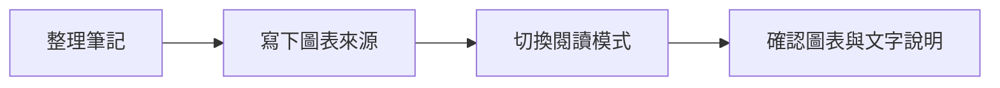

認識 Obsidian 的 Pele 圖表引擎，確認適用版本、使用 Mermaid 區塊繪圖，並將固定版本的 Pele 接入網站專案。

<!--more-->

適用：想在 Obsidian 用文字維護圖表的使用者，以及需要在網站顯示相同圖表來源的開發者。Obsidian 操作以 2026-10-22 發布的桌面 1.15.0 搶先體驗版更新說明為依據；本站安裝的 JavaScript 套件版本為 Pele 1.10.0。

## Pele、Mermaid 與 Obsidian 的關係

在筆記中寫下 `flowchart` 等 Mermaid 語法，仍需要一個渲染器把文字轉成圖表。Pele 就是 Obsidian 團隊開發的圖表渲染器，輸出為 SVG；它使用自己的排版引擎，顏色與字型可配合所在應用程式的主題。

| 名稱 | 在這個流程中的用途 |
| --- | --- |
| Mermaid 語法 | 描述節點、箭頭、分支及其他圖表結構的文字。 |
| Pele | 讀取這些文字並產生圖表的 JavaScript 函式庫。 |
| Obsidian | 編輯與閱讀筆記的應用程式，由它整合圖表引擎。 |

若要查流程圖的節點與分支寫法，可閱讀 [Mermaid 筆記：流程圖語法、驗證與匯出]()。本篇著重如何使用與接入 Pele。

## 在 Obsidian 需要另外安裝嗎？

[Obsidian 桌面 1.15.0 更新說明](https://obsidian.md/changelog/2026-10-22-desktop-v1.15.0/)已列出內建 Pele。該次發布標示為 **搶先體驗版（early access）**；不能把版本號直接當成所有使用者都已收到的穩定版。

1. 先在 Obsidian 的設定中確認目前版本，並對照該版本的官方更新說明是否已包含 Pele。
2. 版本已包含 Pele 時，直接使用 Mermaid 程式碼區塊即可，不必在社群外掛清單尋找或安裝名為 Pele 的外掛。
3. 尚未包含 Pele 的版本，仍可使用原有的 Mermaid 功能。若沒有使用搶先體驗版的需求，可等待所用更新管道提供相應版本。

`npm install pele` 是把函式庫加進網站或應用程式專案的做法；它不會升級 Obsidian，也不會替某個 vault 啟用圖表引擎。

## 在筆記裡放入圖表

新增一篇 Markdown 筆記，先輸入三個反引號並接上 `mermaid`，貼入圖表來源，再以三個反引號結束。完整結構如下，這段是給編輯器的 Markdown：

````markdown

````

在支援的 Obsidian 版本切換至閱讀模式，就會顯示圖表，而不需要插入 `<script>`。本站也以 Pele 顯示同一段流程；可展開「圖表原始碼」查看來源：


`accTitle` 與 `accDescr` 提供圖表的名稱及文字描述。圖表內容是「整理筆記 → 寫下來源 → 切換閱讀模式 → 確認說明」；旁邊的文字也應保留重點，讓只讀文字的讀者能理解流程。

## 主題、窄螢幕與相容性

Obsidian 1.15.0 的更新說明包含圖表配合主題顏色與字型、依筆記寬度調整，以及縮小後的縮放與平移。這些是該版本宿主應用程式提供的體驗；把 Pele 加入自己的網站時，仍需要自行接好版面與操作。

Pele 官方相容性文件以 Mermaid 12.1.0 內建圖表類型為基準，但它的排版與外觀不保證和 Mermaid.js 相同。外部 Mermaid 外掛、JavaScript 點擊回呼及部分設定不能直接照搬。

跨 Obsidian 與網站使用時，保留文字來源，並各自確認重要圖表的節點文字、箭頭、分支與閱讀順序。窄螢幕可能改變排列方向，不能只靠節點的左右位置表達意義。

## 接入網站專案

網站開發者可以安裝固定版本。本次專案使用：

```bash
npm install --save-exact pele@1.10.0
```

若專案使用 JavaScript 模組，最小接法是取得容器，再把圖表來源交給 `mount()`：

```javascript
import { mount } from 'pele';

const container = document.querySelector('#diagram');
const source = 'flowchart LR\n  A[筆記來源] --> B[圖表]';

if (container) {
  mount(container, source, { links: false, images: false });
}
```

`#diagram` 是頁面上既有的圖表容器。`mount()` 會依容器寬度調整圖表；範例關閉節點連結與圖片，避免單純顯示圖表時另外導向網址或載入外部圖片。

本站把固定版本的瀏覽器檔案放在站內，只有含 Mermaid 圖表的文章才載入；一般文章不需多下載這份函式庫。原始碼保留在可展開區塊，JavaScript 未載入或圖表語法錯誤時仍能閱讀。網站的這項安裝與 Obsidian 本身的版本管理是兩件事。

## 沒有顯示圖表時怎麼查

| 現象 | 先檢查什麼 |
| --- | --- |
| 只看到原始文字 | 確認是 `mermaid` 程式碼區塊；在 Obsidian 切換到閱讀模式，並確認目前版本的圖表功能。 |
| 新版功能沒有出現 | 對照實際安裝版本及更新管道；專案中安裝 npm 套件不會改變 Obsidian 的引擎。 |
| 圖表出現語法錯誤 | 先縮成兩個節點與一條箭頭，再逐段加回原內容；確認使用的圖表類型與語法受目前引擎支援。 |
| 圖有出來，但位置和以前不同 | 以標籤與箭頭確認語意；不同引擎及容器寬度可能產生不同排版。 |
| 在 Obsidian 正常，網站只剩原始碼 | 網站也需要整合渲染器；查瀏覽器的腳本載入及錯誤訊息，原始碼保留不代表圖已繪製成功。 |

## 參考資料

- [Obsidian 1.15.0 Desktop：early access 更新說明](https://obsidian.md/changelog/2026-10-22-desktop-v1.15.0/)
- [Obsidian：進階格式與圖表](https://help.obsidian.md/advanced-syntax)
- [Pele 官方儲存庫](https://github.com/obsidianmd/pele)
- [Pele API](https://pele.run/api)
- [Pele 主題](https://pele.run/theming)
- [Pele 相容性](https://pele.run/compatibility)
- [Pele 安全說明](https://pele.run/security)
