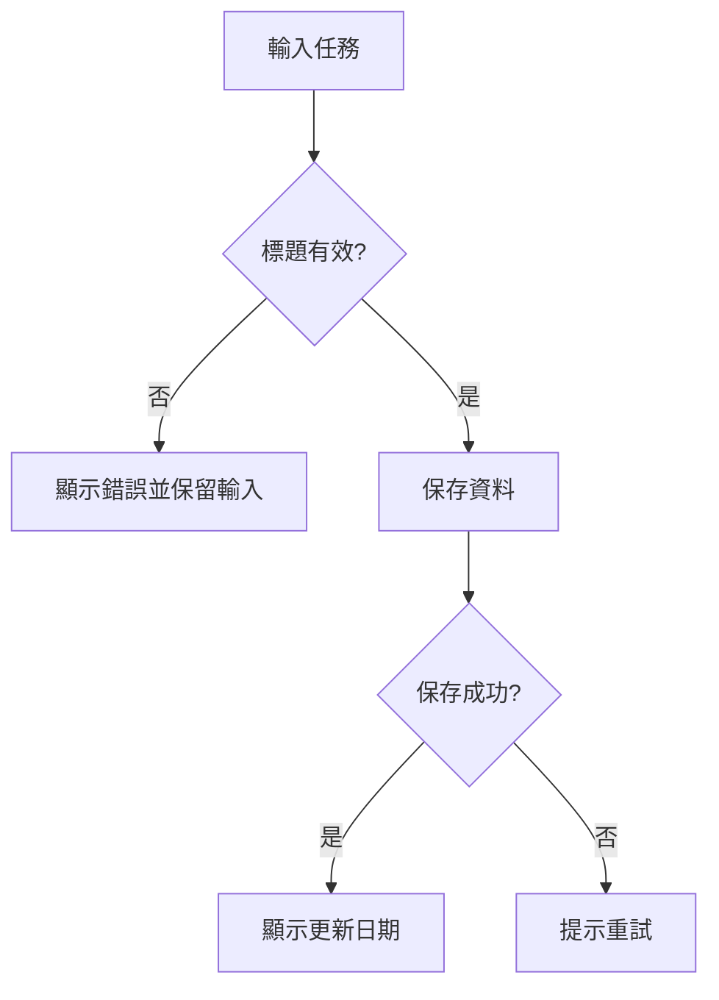

以任務保存流程示範 Mermaid 的節點、箭頭與條件分支，說明渲染需求、流程驗證及 SVG／PNG 匯出。

<!--more-->

適用：以文字維護流程圖、在 Git 中追蹤圖表修改的技術筆記與設計討論。

## Mermaid 與渲染需求

Mermaid 使用文字描述圖表，適合將圖表來源與文件一起放入 Git，透過差異比較追蹤修改。流程圖表示步驟與條件分支；時序圖表示參與者之間的呼叫順序，ER 圖則表示資料關係。先依問題選擇圖表類型，不是所有圖都叫流程圖。

Markdown 中標記為 `mermaid` 的程式碼區塊，需要編輯器或網站提供渲染器才會出圖；只有語言標記並不足夠。本站已使用 Pele 顯示圖表，可展開「圖表原始碼」查看來源；載入或繪圖失敗時仍會保留原始碼。Obsidian 的使用方式與網站接法另見 [Pele 使用筆記]()。

## 流程圖範例

此例先檢查標題，再嘗試保存資料；標題無效時保留輸入，保存失敗時提示重試。

### 節點、箭頭與條件分支

| 語法 | 意義 |
| --- | --- |
| `flowchart TD` | 宣告由上往下排列的流程圖；若需由左往右排列，可改用 `LR`。 |
| `A[輸入任務]` | `A` 是節點識別碼，方括號中的文字顯示在矩形節點內。 |
| `B{標題有效?}` | 大括號建立菱形節點，用來表示本例的判斷。 |
| `A --> B` | 箭頭連接節點，表示由 A 前往 B。 |
| `B -->\|否\| C` | 箭頭上的「否」是分支標籤，表示條件不成立時前往 C。 |

分支標籤只是圖上的說明，不會執行條件判斷。繪圖時要把成功、錯誤與取消等實際路徑畫清楚，避免用巨大圖掩蓋尚未決定的業務規則。

## 驗證與匯出

1. 將範例中從 `flowchart TD` 開始的內容貼到 Mermaid Live Editor，不包含外層的三個反引號。
2. 確認預覽有「標題有效／無效」與「保存成功／失敗」兩組分支；若出現語法錯誤，依編輯器提示檢查節點與連線。
3. 沿箭頭核對三條路徑：標題無效時到 C、標題有效且保存成功時到 F、標題有效但保存失敗時到 G。此例的 C、F、G 是流程終點，不需要再接回其他節點。
4. 從編輯器匯出 SVG 或 PNG，確認中文字、分支標籤與箭頭在預計使用的尺寸仍可閱讀；手機閱讀也要能辨識，並在圖旁保留文字說明。

保留可編輯的 Mermaid 來源與版本紀錄，外部分享連結或匯出的圖片都不能取代來源檔。外部 Live Editor 分享可能包含系統資訊，不上傳秘密或內網地址；相關資料應在授權環境處理。

本站使用固定版本的 Pele 與同源腳本，保留既有 CSP 與關閉原始 HTML 的設定。若要匯出 SVG／PNG，仍可將圖表來源貼到 [Mermaid Live Editor](https://mermaid.live/) 操作。

## 何時改用圖形編輯器

需要自由拖拉或精細控制複雜版面時，可改用 diagrams.net，並儲存可編輯來源。白板適合討論快稿；定稿時仍需寫清楚符號、輸入與輸出。

## 參考資料

- [Mermaid 簡介](https://mermaid.js.org/intro/)
- [Mermaid flowchart](https://mermaid.js.org/syntax/flowchart.html)
- [Mermaid Live](https://mermaid.live/)
- [diagrams.net](https://www.drawio.com/docs/)
- [Online FlowChart & Diagrams Editor - Mermaid Live Editor](https://mermaid.live/edit#pako:eNp1kltPgzAUx79K0xdfdiljF2h0RjNd9HGbMTG8NHDGGqHFtkTnsu9uKbBL5iAh9H_O738u6Q7HMgFMsYavEkQMM85SxfJIIPsUTBke84IJg56VFAZEchl5ZPHnv4GH0mzIpTyXMs0gEnWk9e1Op40RRfOnFepnMuWinzbJVWoTt5nOmaKlPWmkqta1Qd_cbBpz5GAkC8NlU8chFq0TKFpAwhXERqM3DQoZeY4WLIWLBlvWEWBVpVsqVpBYhbNM11itH3tdgCmVqKvdHLCXma1sh7rWo5usaZGLtVQ5q0ZCpeYiPUWvlWu7P6XPix22Xm_Tyej1fXXqftx860eRTwaor8F0Xd69-97dWnBaEbiDc7D1eGIv165yibDZQA4RpvY3gTUrMxPhSOxtKiuNXG5FjKlRJXRwWSTMtHexFe3l-ZDy9IjpDv9g6hHS871xYF9_MgzHw6CDt1YOhr3A84NgNPI8j4SDwb6Df50D6YW-Nwk9nxCfjCbhKNz_AZyq_-w)
